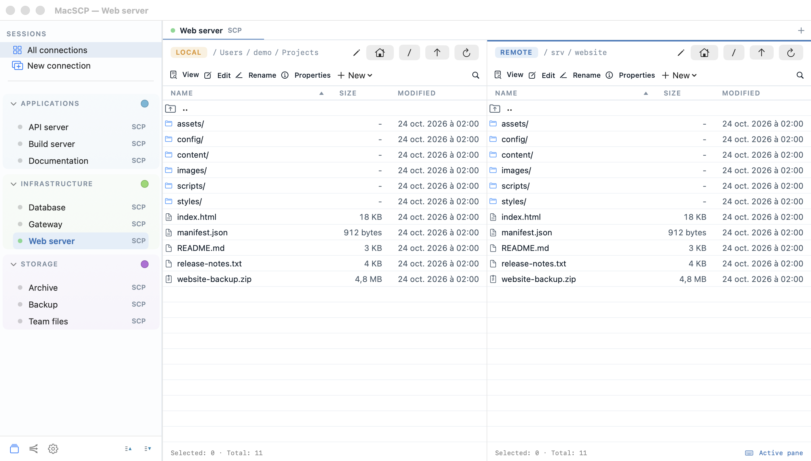
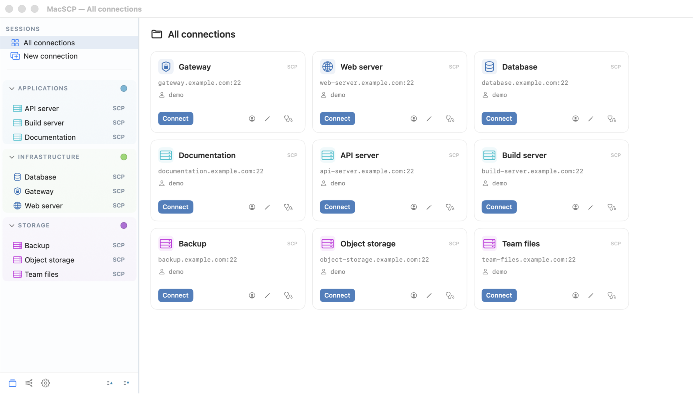
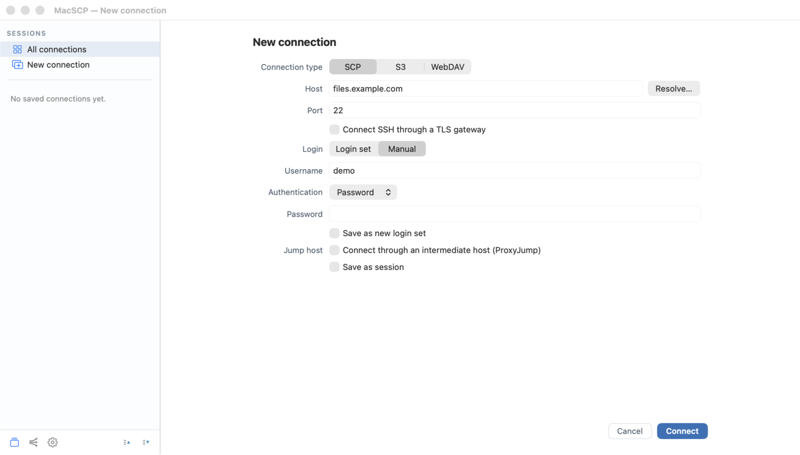
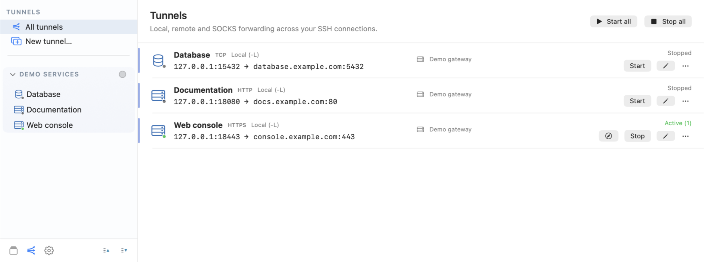

[](https://github.com/retrotools-apps/MacSCP/actions/workflows/ci.yml)

<p align="center">
  <strong>Native file transfers and SSH tunnels for macOS.</strong><br>
  macOS 15+ · Apple Silicon &amp; Intel · Version 1.0.0 · GPLv3+
</p>

<p align="center">
  <a href="https://github.com/retrotools-apps/MacSCP/releases"><strong>Get MacSCP ↗</strong></a>
  &nbsp; · &nbsp;
  <a href="docs/USER_GUIDE.md">User guide</a>
  &nbsp; · &nbsp;
  <a href="CHANGELOG.md">What's new</a>
  &nbsp; · &nbsp;
  <a href="#build-from-source">Build from source</a>
</p>



## Two panes. Your next move.

Browse local and remote files side by side, then drag, drop or queue your next
transfer. MacSCP is an independent application by RetroTools, built around native
Mac controls.

- **Transfer with control.** SFTP over SSH, S3 and WebDAV; file and folder queues,
  conflict handling, cancellation, bandwidth limits and checksums.
- **Pair two remotes.** Drop one connected SCP tab onto another. Different
  servers copy through your Mac without credential delegation. Identical SSH
  endpoints, accounts and routes can copy on the server.
- **Stay with the file.** A built-in UTF-8 editor, bounded text and hex previews,
  remote search, and external-editor save/upload workflows.

## Your servers. In order.

Keep connections in nested groups, give them recognizable icons and reuse saved
logins, SSH keys or your local SSH agent. Import OpenSSH configuration, supported
Cyberduck bookmarks and WinSCP INI files, or exchange MacSCP session exports.



<details>
<summary><strong>A closer look at connection setup</strong></summary>



</details>

Available in English, French, German, Spanish, Italian, Romanian and Polish.

## Keep the route. Lose the shell script.

Local and remote forwarding, SOCKS5, an optional jump host and TLS gateways —
in a dedicated workspace. Start one tunnel or a group, configure automatic
startup and reconnection, and keep tunnels running independently of file tabs.



Check the configured connection route, inspect server information, or run an
on-demand upload/download test. Need a shell? Open the session in your preferred
external SSH terminal.

## Download

Official installers and release notes are distributed through
[GitHub Releases](https://github.com/retrotools-apps/MacSCP/releases).
GitHub builds do not require a paid Apple developer account. The application
uses an ad-hoc code signature and is **not Apple-notarized**. macOS may block
the first launch; follow Apple's per-application approval procedure in
System Settings → Privacy & Security. Do not disable Gatekeeper globally.

For packaged releases, open the DMG and drag MacSCP into Applications.
Direct-distribution updates use signed Sparkle feeds and require confirmation
before installation. Source builds can be rebuilt locally.

Release archives and update feeds carry GitHub build-provenance attestations.
After downloading a release, verify its provenance with the GitHub CLI:

```sh
gh attestation verify MacSCP-1.0.0.dmg --repo retrotools-apps/MacSCP
```

Use the downloaded version's filename. The CI badge reports test status;
the attestation establishes build provenance; Sparkle signatures authenticate
updates. None of these is an Apple Developer ID signature or notarization.

## Documentation

- [User guide](docs/USER_GUIDE.md) — connections, transfers, paired remotes,
  tunnels, diagnostics and settings.
- [Changelog](CHANGELOG.md) — release highlights, also available in the app's
  **What's new** section.
- [Security policy](SECURITY.md) — credential boundaries and vulnerability reporting.
- [WinSCP interoperability](docs/WINSCP_FORMAT.md).
- [Dependency provenance](docs/DEPENDENCY_FORKS.md) and
  [third-party notices](THIRD_PARTY_NOTICES.md).

## Build from source

Requirements: macOS 15 or later and an Xcode toolchain supporting Swift 6
and Swift Build.

```sh
scripts/check-vendor
swift package resolve
scripts/dev build
scripts/dev run
```

Run the unit suite with `swift test`.

Non-Apple dependencies are versioned source trees in `Vendor/`. Official Apple
packages use exact versions and the committed `Package.resolved` lock.
`scripts/package-app` assembles a universal application. The GitHub release
path uses free ad-hoc signing and requires no Apple certificate. Saved secrets
use the standard macOS Keychain; optional biometric protection requires an
Apple-signed build with the appropriate Keychain entitlements.

## Your credentials stay yours.

Saved passwords and passphrases belong in the macOS Keychain, not session JSON.
Unknown SSH host keys require confirmation; changed keys stop the connection.
Review exported diagnostics before sharing: hostnames and paths may be sensitive.

<details>
<summary><strong>Protocols and practical limits</strong></summary>

File sessions use SFTP over SSH, not the legacy SCP wire protocol. FTP, SMB and
AFP are not supported. One SSH jump host is supported. Same-server copies need
a POSIX shell and `cp`; unsupported copies fail rather than silently changing
route. See the user guide for protocol-specific limits.

</details>

## Support and contributions

Report bugs and suggestions in
[GitHub Issues](https://github.com/retrotools-apps/MacSCP/issues).
Include the application version, macOS version and reproduction steps.
Remove credentials and sensitive server information from attachments.
For suspected vulnerabilities, follow [SECURITY.md](SECURITY.md).

Contributions should include relevant behavioral tests and localized interface
text. Do not add real credentials, private configuration or personal screenshots.

## License

MacSCP is licensed under the [GNU GPL version 3 or later](LICENSE).
© 2026 RetroTools. Third-party components retain their own licenses.
See the [application notice](licenses/macSCP-NOTICE.txt) for attribution and
the GPLv3-or-later grant.
