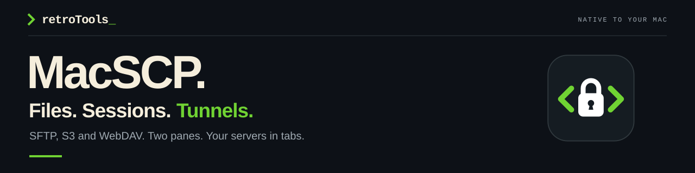
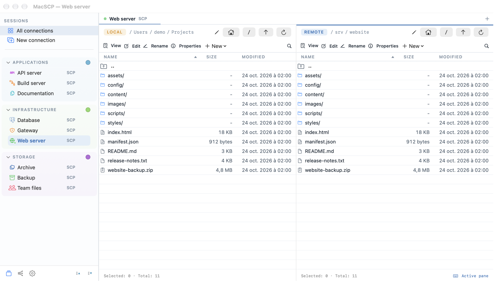
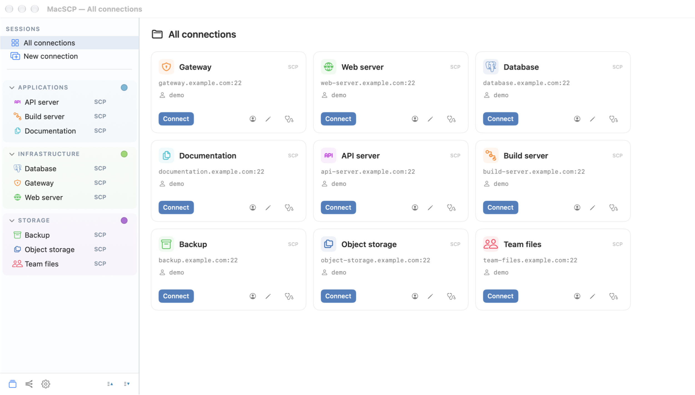
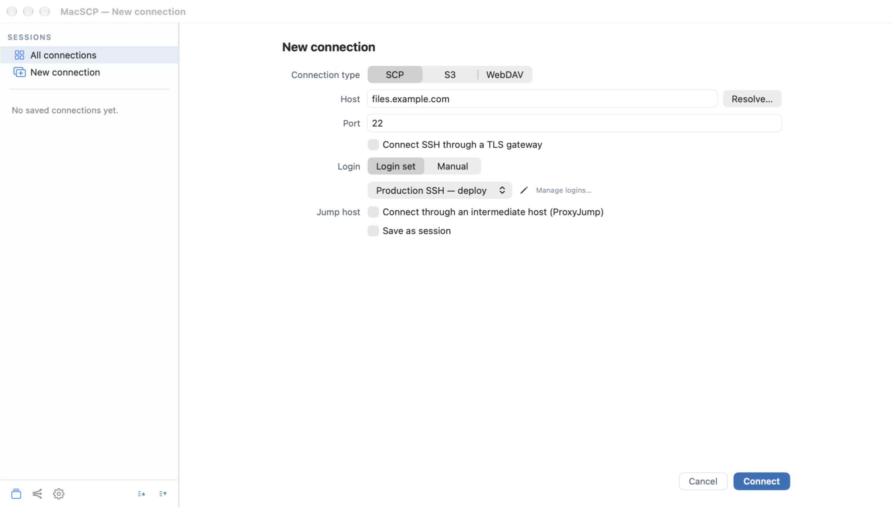
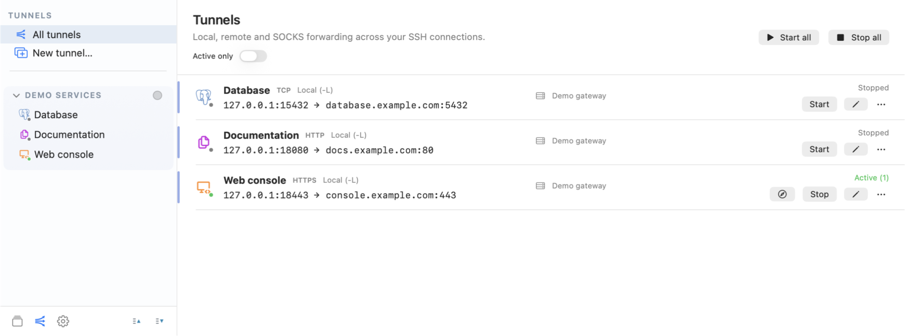

[](https://github.com/retrotools-apps/MacSCP/actions/workflows/ci.yml)

<p align="center">
  <strong>Remote file operations and managed SSH tunnels for macOS.</strong><br>
  For sysadmins, platform teams and integration developers.<br>
  macOS 15+ · Apple Silicon &amp; Intel · GPLv3+
</p>

<p align="center">
  <a href="https://github.com/retrotools-apps/MacSCP/releases/latest"><strong>Get MacSCP ↗</strong></a>
  &nbsp; · &nbsp;
  <a href="docs/USER_GUIDE.md">User guide</a>
  &nbsp; · &nbsp;
  <a href="CHANGELOG.md">Release notes</a>
  &nbsp; · &nbsp;
  <a href="#build-from-source">Build from source</a>
</p>



## Work directly where systems live.

Browse, edit and transfer files between your Mac and remote systems in a native
workspace. MacSCP supports SFTP over SSH, S3-compatible storage and WebDAV.

- **Move data with control.** Queue files and folders, resolve conflicts, cancel
  work, limit bandwidth and verify checksums.
- **Change the file in place.** Edit UTF-8 configuration files, search SSH
  folders and inspect bounded text or hexadecimal windows without loading an
  entire large or binary file.
- **Put two servers side by side.** Pair two SSH/SFTP sessions and transfer
  between them without sharing credentials. Compatible sessions on the same
  endpoint and account can copy directly on the server.

## Keep everyday environments organized.

Group related endpoints, choose recognizable icons and colors, and reuse login
sets backed by passwords, private keys or the local SSH agent. Import selected
OpenSSH, Cyberduck and WinSCP configurations, then review them before connecting.



<details>
<summary><strong>A closer look at reusable login sets</strong></summary>



</details>

Customize group contrast, sidebar density, colors and identity icons. The
interface is available in English, French, German, Spanish, Italian, Romanian
and Polish.

## Treat tunnels as infrastructure.

Configure local or remote forwarding and SOCKS5 in a dedicated workspace. Reuse
saved SSH connections, an optional jump host and supported TLS-gateway settings.

- Start one tunnel or a related group, filter active mappings and control them
  from the menu bar.
- Keep tunnels independent of file tabs, with optional startup and automatic
  reconnection.
- Open active local HTTP or HTTPS mappings directly in a browser.
- Inspect the process holding an occupied local port before choosing whether to
  free it and restart the tunnel.



## Know what connects. Know what is stored.

- **Credentials stay out of session files.** Saved passwords and passphrases
  use macOS Keychain. Unknown SSH host keys require explicit confirmation; a
  changed key stops the connection.
- **No analytics or background telemetry.** Network access is limited to
  configured connections, signed update checks and optional public-IP discovery
  on your server.
- **Diagnostics and local audit trails.** Inspect endpoints and jump routes,
  trace failures, review server information and measure throughput. Optional
  audit logs exclude passwords, keys and file contents.
- **Reviewed code, visible limits.** The public source is subject to repeated
  source-level security review. These reviews must not be interpreted as an
  independent certification or a substitute for penetration and runtime testing.

Need a shell? Open the selected SSH connection in your preferred external
terminal. MacSCP does not include an integrated terminal emulator.

## Install the latest stable release.

Download the current package from
[GitHub Releases](https://github.com/retrotools-apps/MacSCP/releases/latest),
open the DMG and drag MacSCP into Applications.

GitHub builds use an ad-hoc code signature and are **not Apple-notarized**.
macOS may block the first launch; follow the per-application instructions on the
release page or in System Settings → Privacy & Security. Do not disable
Gatekeeper globally.

Direct-distribution updates use signed Sparkle feeds and require confirmation
before installation. Release archives and update feeds carry GitHub
build-provenance attestations. In a directory containing the downloaded DMG:

```sh
gh attestation verify MacSCP-*.dmg --repo retrotools-apps/MacSCP
```

The CI badge reports test status, the attestation establishes build provenance,
and Sparkle signatures authenticate updates. None of these is an Apple Developer
ID signature or notarization.

## Documentation

- [User guide](docs/USER_GUIDE.md) — connections, remote editing, large-file
  inspection, paired remotes, tunnels, diagnostics and appearance.
- [Release notes](CHANGELOG.md) — features, fixes and maintenance changes.
- [Security policy](SECURITY.md) — security boundaries and private reporting.
- [WinSCP interoperability](docs/WINSCP_FORMAT.md).
- [Dependency provenance](docs/DEPENDENCY_FORKS.md) and
  [third-party notices](THIRD_PARTY_NOTICES.md).

## Build from source

Requirements: macOS 15 or later and an Xcode toolchain supporting Swift 6 and
Swift Build.

```sh
scripts/check-vendor
swift package resolve
scripts/dev build
scripts/dev run
```

Run the unit suite with `swift test`.

Non-Apple dependencies are versioned source trees in `Vendor/`. Official Apple
packages use exact versions and the committed `Package.resolved` lock.
`scripts/package-app` assembles a universal application. The GitHub release path
uses free ad-hoc signing and requires no Apple certificate. Optional biometric
Keychain protection requires an Apple-signed build with the appropriate
entitlements.

<details>
<summary><strong>Protocols and practical limits</strong></summary>

File sessions use SFTP over SSH, not the legacy SCP wire protocol. FTP, SMB and
AFP are not supported. SSH routes support one jump host; multi-hop jump chains
are not supported. Same-server copies need a POSIX shell with `cp`; unsupported
copies fail rather than silently changing route. See the user guide for
protocol-specific limits.

</details>

## Support and contributions

Report ordinary bugs and suggestions through
[GitHub Issues](https://github.com/retrotools-apps/MacSCP/issues). Include the
MacSCP version, macOS version and reproduction steps, after removing credentials
and private infrastructure data. For suspected vulnerabilities, follow the
[security policy](SECURITY.md).

Contributions should include relevant behavioral tests and localized interface
text. Do not add real credentials, private configuration or personal screenshots.

## License

MacSCP is licensed under the [GNU GPL version 3 or later](LICENSE).
© 2026 RetroTools. Third-party components retain their own licenses. See the
[application notice](licenses/macSCP-NOTICE.txt) for attribution and the
GPLv3-or-later grant.
